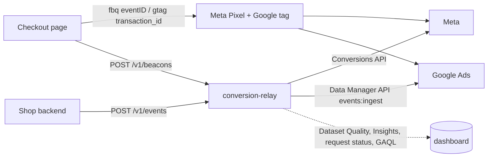

# conversion-relay

A small FastAPI service that sends a shop's conversions server-side to the **Meta Conversions API** and to
**Google enhanced conversions** (Data Manager API), deduplicated against the browser tags, and a
monitoring dashboard for **event match quality, latency, coverage** and **internal vs platform-reported
attribution**. A **sandbox mode** simulates both platforms in-process, so the whole thing, including the
double counting that broken dedup keys cause, can be demonstrated without ad accounts.



## Quick start: the sandbox demo

```bash
python3 -m venv .venv && . .venv/bin/activate
pip install -r requirements-dev.txt
python -m relay seed              # 14 days of simulated history into sandbox.db (about a second)
python -m relay serve --sandbox   # http://127.0.0.1:8000
```

`seed` replays two weeks of orders through the real relay code (ingest, hashing, dispatcher, the
Meta and Google clients); only the platforms at the other end are simulated. The first 7 days use a
**broken** set-up, the last 7 a **fixed** one, so the dashboard shows the change:

| Set-up | Browser tags | Server event | What the platforms do |
|---|---|---|---|
| broken | Pixel makes up its own `eventID`; Google tag sends no `transaction_id` | own ids, no `_fbp`/`_fbc` cookies forwarded | count most orders twice |
| fixed (shared) | `eventID` = order id; `transaction_id` = order id | same ids, cookies forwarded | keep one conversion per order |

A demo walk-through:

1. **Dashboard → Deduplication.** The daily key match rate jumps from 0% to 100% on the day of the fix;
   "Tag only" counts the browser hits whose key matched no server event.
2. **Attribution.** "Meta per day" shows Meta's reported conversions at about 2-3× the internal last
   click before the fix and close to it after. Google drops too but stays near 2×: its 30-day click
   window and the GCLID cookie credit orders whose last click was elsewhere. What remains after the fix
   is the platforms' own attribution (view-through, longer windows), not double counting.
3. **Event match quality.** Meta's EMQ, key coverage and dedup-key feedback, and the relay's own
   estimate per day (it rises when the fix starts forwarding `_fbp`/`_fbc`). Google's processing
   diagnostics show a few records rejected for a truncated GCLID.
4. **Latency.** p50/p95 per platform; p99 shows retries after simulated outages (2% of requests).
5. **Demo page (`/demo`).** Place orders live: choose shared or broken keys, the ad journey, an ad
   blocker, consent and the customer data. Each order shows the hits each platform received and which
   one it kept. A broken order shows two counted hits (`×2`); an ad-blocked order is recovered by the
   server event alone; refused consent sends nothing.

`python -m relay seed --reset` starts the sandbox over. `python -m relay report --sandbox` prints the
same numbers in the terminal.

## Sending events

### Server: `POST /v1/events`

From the shop's backend when the order is paid (with `Authorization: Bearer $RELAY_API_KEY` when set):

```bash
curl -X POST http://127.0.0.1:8000/v1/events -H 'Content-Type: application/json' -d '{
  "event_id": "ord-1042",
  "event_name": "Purchase",
  "event_time": "2026-11-10T14:03:11Z",
  "event_source_url": "https://shop.example/checkout/thank-you",
  "value": 89.00,
  "currency": "USD",
  "order_id": "ord-1042",
  "user": {
    "email": "Jane.Doe@gmail.com", "phone": "+1 512 555 0147",
    "first_name": "Jane", "last_name": "Doe", "city": "Austin", "state": "TX", "zip": "78701", "country": "US",
    "external_id": "cust-81", "client_ip": "203.0.113.7", "user_agent": "Mozilla/5.0 ...",
    "fbp": "fb.1.1762780000000.1234567890", "fbc": "fb.1.1762779000000.IwAR..."
  },
  "click": {"gclid": "Cj0KCQiA...", "utm_source": "google", "utm_medium": "cpc",
            "utm_campaign": "Search - brand", "utm_id": "21000000001", "clicked_at": "2026-11-10T13:40:00Z"},
  "consent": {"ad_user_data": true, "ad_personalization": true}
}'
```

Response `202` with each destination's delivery status (`pending` or `skipped`). The same
`event_name` + `event_id` again returns `200` with `"duplicate": true` and sends nothing: retries from
the shop are safe. `POST /v1/events/batch` takes `{"events": [...]}` (up to 500).

| Field | Use |
|---|---|
| `event_id` | Dedup key. Meta: `event_id`, must equal the Pixel's `eventID`. Use the order id. |
| `order_id` | Google `transactionId`, must equal the Google tag's `transaction_id`. Defaults to `event_id`. |
| `user.*` | Raw customer data; the relay normalises and hashes it per platform and never stores it. `client_ip`, `user_agent`, `fbp` and `fbc` are sent unhashed, as both platforms require. |
| `click` | The last ad click the site saw (keep click ids and UTMs in a first-party cookie at landing). Feeds Google's `gclid`/`gbraid`/`wbraid`, Meta's `fbc` (built from `fbclid` when the cookie is missing), and the internal attribution. `utm_id` lets the dashboard join campaigns by id. |
| `consent.ad_user_data` | `false`: nothing is sent to either platform (counted as skipped). Missing: sent, without a consent signal. |

What each platform gets: Meta, every event (website events need `user_agent`); Google, the events
named in `GOOGLE_EVENTS` (default `Purchase`) that carry customer data, a click id or an IP address.

### Browser: share the keys, post a beacon

```html
<script>
  const orderId = "ord-1042";
  fbq("track", "Purchase", {value: 89.00, currency: "USD", order_id: orderId}, {eventID: orderId});
  gtag("event", "conversion", {send_to: "AW-XXXXXXX/LABEL", value: 89.00, currency: "USD", transaction_id: orderId});
  // Optional: lets the dashboard pair browser and server events (dedup key match rate).
  for (const tag of ["meta_pixel", "google_tag"]) {
    fetch("https://relay.example.com/v1/beacons", {method: "POST", keepalive: true,
      headers: {"Content-Type": "application/json"},
      body: JSON.stringify({event_id: orderId, event_name: "Purchase", tag})});
  }
</script>
```

The page's origin must be in `ALLOWED_ORIGINS`. Beacons carry no customer data and need no key, so
anyone can post them; they only feed the dedup panel.

## Live setup

Leave `RELAY_MODE` unset (live), copy `.env.example` to `.env`, fill it in, export it and run
`python -m relay serve`. Either platform can be left out.

**Meta.** `META_PIXEL_ID` is the dataset (pixel) id; `META_ACCESS_TOKEN` a system user token generated
in Events Manager (Settings → Conversions API) or Business Settings, with the pixel assigned. The same
token reads the Dataset Quality API. For the reported conversions set `META_AD_ACCOUNT_ID`; the token
then needs `ads_read`. To check deduplication before going live, set `META_TEST_EVENT_CODE` from Events
Manager → Test events, fire the Pixel with the same `eventID` and watch the server event show as
deduplicated; remove the code afterwards (test events are not counted).

**Google.** Since June 2026 server-side conversion data goes through the
[Data Manager API](https://developers.google.com/data-manager/api/devguides/events/google-ads/online/send-events);
the Google Ads API upload services no longer take it. The relay sends each conversion as a
multi-source event to a **Website** (`WEBPAGE`) conversion action that the Google tag also reports,
keyed by `transactionId`: Google merges it with the tag conversion (adding hashed customer data the
tag lacked, which is enhanced conversions) or records it when the tag missed it. Needed:

- `GOOGLE_CUSTOMER_ID` (the account owning the action, hyphens allowed), `GOOGLE_CONVERSION_ACTION_ID`,
  and `GOOGLE_LOGIN_CUSTOMER_ID` when signing in through a manager account.
- Enhanced conversions turned on (Goals → Settings → Customer data use) and the customer data terms
  accepted.
- An OAuth client (Desktop app) and a refresh token for a Google user with access to the account, with
  the scopes `https://www.googleapis.com/auth/datamanager` and, for reporting,
  `https://www.googleapis.com/auth/adwords` (for example through the
  [OAuth 2.0 Playground](https://developers.google.com/oauthplayground/) with your own client).
- `GOOGLE_DEVELOPER_TOKEN` only for the reported conversions (Google Ads API). Delivery needs none.
- `GOOGLE_VALIDATE_ONLY=1` to have Google check requests without ingesting them (deliveries end as
  `validated`).

Google keeps data from a new multi-source source out of bidding for a 14-day trial; it is reported
meanwhile.

**Deploying.** The `Dockerfile` runs `python -m relay serve --host 0.0.0.0` on `$PORT`. Mount a volume
and set `RELAY_DB=/data/relay.db`. Serving beyond localhost requires `RELAY_API_KEY` and
`DASHBOARD_PASSWORD`. Without them the relay only answers requests addressed to localhost, judged by the
`Host` header, so behind a reverse proxy set both even when the relay itself listens on 127.0.0.1. Run
one instance per database: the dispatcher threads live in the process.

Set `REPORT_TIMEZONE` to the ad accounts' time zone (Meta: ad account settings; Google Ads: account
settings). The platforms date their reports in it, and the dashboard counts the relay's own days in it
too, so the daily comparison lines up.

## The dashboard

`/` (the last 1, 7, 14 or 30 calendar days in `REPORT_TIMEZONE`, today included), `/events` (latest
events with per-destination status, latency and match keys), `/api/metrics?days=7` (the same numbers
as JSON), `/docs` (OpenAPI). "Refresh platform data" pulls from the platforms now; the monitor also
does it every `MONITOR_INTERVAL_SECONDS`.

| Panel | Numbers | Source |
|---|---|---|
| Deduplication | Tag fired, server events, matched pairs, server only (no tag fired: conversions the browser lost and the server recovered; orders with refused consent are left out), tag only (keys that matched nothing: double counts, or a server event still to come), daily key match rate | Beacons joined to events on `event_id` (Meta) and `transaction_id` (Google) |
| | Meta's dedup keys: share of browser and server events carrying `event_id`/`fbp`/`external_id`, and browser events deduplicated through each; event coverage | Meta Dataset Quality API |
| Event match quality | Meta EMQ (0-10) and rating per event, key coverage as Meta sees it, diagnostics, data freshness, share over 2 h late, additional conversions reported | Meta Dataset Quality API (last 7 days) |
| | Relay estimate per event and per day: a weighted score of the keys sent (email and phone first, then click id, external id, browser id, IP and user agent, name and address). A heuristic for early warning, not Meta's formula | Relay |
| | Google: share of events with each identifier; processing status per request; records rejected after acceptance, by reason | Data Manager diagnostics (`requestStatus:retrieve`, 30 min after each request) |
| Latency | p50/p95/p99/max from receipt to platform acceptance (queueing and retries included), API call p95, API error rate, share reaching the platform over 2 h / 24 h after the event | Relay |
| Delivery coverage | Per platform: sent, waiting, failed, rejected, skipped (with reasons), retried; delivery rate (of what was attempted) and coverage (of everything received) | Relay |
| Attribution | Per platform: internal last-click conversions against what the platform reports, ratio, revenue; orders against Meta + Google claims per day; per campaign | Relay events; Meta Insights (`action_report_time=conversion`); Google Ads `all_conversions_by_conversion_date` for the relay's conversion action |

Internal attribution is last click: each order goes to the channel of the last ad click in its
`click` context if it is within `CLICK_LOOKBACK_DAYS`, else `direct`. Each platform instead credits
every conversion it can match to its own last click or view in its own window, so Meta's and
Google's numbers overlap and their sum can exceed the orders.

Delivery statuses: `pending` (queued or waiting for a retry), `sent` (accepted), `validated`
(Google validate-only), `failed` (gave up: the platform refused the event, it was too old for Meta, or
it was still failing 7 days after it happened), `rejected` (Google accepted the request, then failed the
record in processing; a repeated transaction ID is not counted, since Google already has that
conversion), `skipped` (refused consent, no identifiers; for Meta also a website event without a user
agent or `event_source_url`, and app events, which need device data the relay does not take).

## How delivery works

- **Idempotent intake.** `(event_name, event_id)` is unique; a repeat is counted (`duplicate_hits`) and dropped.
- **Batching and retries.** One dispatcher thread per platform (a slow or failing platform never delays
  the other) sends what is due in batches of up to 500, at once after each event. 5xx, 429, network
  errors, Meta's transient codes and token or permission errors (including a token not assigned to the
  pixel) retry with backoff, 10 s doubling up to 1 h, until 7 days after the event: an outage or an
  expired token of hours or days loses nothing once it is fixed. A request refused as a whole (one bad
  event) is split and each event sent alone, so only the bad one fails. Meta events older than 7 days
  are failed before sending, since one would sink the whole request.
- **At-least-once.** A crash between sending and recording resends the batch; Meta drops the repeat on
  `event_id`, Google on `transactionId`.
- **Privacy.** Raw customer data is never stored. Events keep only which keys were present; the payload
  (hashes, IP, user agent) lives in the delivery row until the platform accepts it or the relay gives up
  (at most 7 days after the event), then it is deleted. Monitoring errors are stored with the Meta
  access token redacted.

## The sandbox model

`relay/simulator.py` answers the same HTTP requests the platform clients make (Conversions API,
Dataset Quality API, Insights, OAuth, Data Manager ingest and status, Google Ads search). It follows
the documented rules that matter here: Meta keeps the first of a browser and a server event with the
same `event_name` + `event_id` within 48 hours, falls back to `fbp`/`external_id` only when the browser
event came first; Google keeps one conversion per `transactionId` per action, and a server event
merges into the tag conversion (filling in missing customer data). Each platform credits matched
conversions to its own last interaction (Meta 7-day click / 1-day view, Google 30-day click). The
match rates, latency (median 110 ms Meta, 240 ms Google), the 2% outage rate and the journey mix are
invented, but deterministic for a seed. A database created in sandbox mode can not be opened in live
mode and the other way round.

## Commands

```bash
python -m relay serve [--sandbox] [--host 127.0.0.1] [--port 8000]
python -m relay seed [--days 14] [--orders-per-day 60] [--broken-days 7] [--seed 7] [--reset]
python -m relay report [--sandbox] [--days 7] [--json]
python -m relay refresh [--sandbox]      # pull platform data once
python -m pytest                         # tests: no network, no keys
```

In live mode `serve` sends real events to Meta and Google, and `refresh` and the monitor read from
their APIs.
